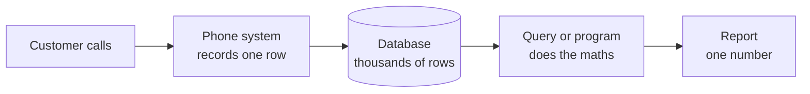
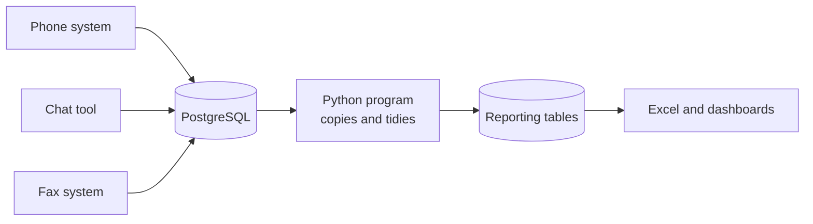

# Module 1: How reporting data flows

Time: 35 minutes. No laptop needed.

By the end of this module you can follow one customer call from the phone to a number in a report, and you know the main words people use when they talk about data.

## A call becomes a number

Before any technology, follow one call.

1. A customer rings. The phone system records when the call arrived, who answered and how long it lasted. That record is one row in a database.
2. Every day thousands of such rows pile up.
3. Someone asks a question: "What was our abandonment rate in the Billing queue yesterday?"
4. A query or a program turns thousands of rows into one number.
5. The number goes into a report or dashboard that managers read.

This whole course is about the boxes in the middle: where the rows are kept, how you ask questions of them, how you clean them, and how you make the process repeatable.

## Database, table, row, column

> [!TIP]
> A database is a filing room. A table is one cabinet in it, for example the cabinet of calls. A row is one folder in the cabinet, which is one call. A column is one question every folder answers, such as "how long did the caller wait?"

You will see these four words every hour today.

## What makes data "big"

People describe big data with three words that all begin with V.

> [!TIP]
> Picture a busy jeepney terminal. Volume is how many jeepneys arrive in a day. Velocity is how fast they come and go. Variety is how different they are: minibuses, tricycles, vans, each with its own paperwork.

A contact centre has all three. Volume is thousands of calls and chats a day. Velocity is a queue that changes every few seconds. Variety is phone records, chat transcripts and fax images that look nothing alike.

About 51,000 calls in a month fit comfortably on a laptop. Teams move to bigger platforms for other reasons: the data sits in many places, several teams need it at once, and somebody has to be able to say who changed what.

## Batch or streaming

> [!TIP]
> Batch is the monthly electricity bill: usage is collected, then one total arrives. Streaming is the meter on the wall showing the number moving right now.

A lot of reporting is batch. A report that refreshes every morning is batch. A wallboard of callers waiting right now is streaming. Streaming costs more to build, so the useful question is: would anyone act differently if they saw this five minutes sooner?

## Two kinds of database work

> [!TIP]
> OLTP is the cashier at the till, recording one sale at a time, fast and accurately. OLAP is the store manager at closing time asking "which hour sold the most?", which means reading thousands of sales at once.

If the manager asks that question at the till, the cashier slows down. This is why reporting data is copied somewhere else instead of being worked out on the live phone system.

## Warehouse, lake and lakehouse

> [!TIP]
> A warehouse is a supermarket shelf: everything cleaned, labelled and in its place. A lake is water as it arrives from the river: unfiltered, anything can go in. A lakehouse is a lake with a filtration plant and labelled taps, so you keep the flexibility of raw water and still get drinkable water out.

Tomorrow you build a lakehouse in Microsoft Fabric. Today you work with a database and a few small programs. The ideas carry straight across.

## Where your reporting is today, and where it is going

Tomorrow the same data flows through Fabric and ends in a Power BI report. Each box has a modern counterpart, and you will meet them one at a time.

## Jargon decoder

| You will hear | It means | Picture |
| --- | --- | --- |
| Database | Organised storage for tables | A filing room |
| Query | A question asked of a database | Asking the file clerk |
| ETL | Extract, transform, load: copy, tidy, store | Market, kitchen, plate |
| Pipeline | A repeatable chain of steps that moves data | A conveyor belt |
| Schema | A group of tables inside a database | A room in the filing room |
| KPI | A number the business tracks | A dashboard gauge |

More terms are in the [glossary](../appendix/glossary.md).

## Exercise: map your reporting flow

Do the [flow-mapping exercise](exercise-map-the-flow.md) in groups of four.

## Check yourself

1. A report refreshes once each night. Is that batch or streaming?
2. In the filing room picture, what is a row?
3. Why not run a heavy report on the live phone system?

Answers

1. Batch.
2. One folder in a cabinet, which is one record, for example one call.
3. It slows down the system that agents and customers are using at that moment.

