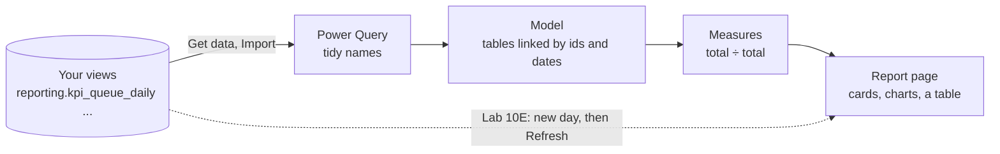

# Module 10: Power BI

Time: 100 minutes

Your views hold the counts. Now you put them in front of people: a one-page dashboard a team leader could open every morning, that updates when new data arrives.

> [!TIP]
> The dining room. The kitchen (Modules 8 and 9) has done the work. The dining room decides how the food is served: which plate, in what order, how much at once. It never cooks. Power BI should not hold your KPI rules either. It divides totals the views already hold, and draws them.

## How Power BI fits in

| Word in Power BI | Meaning | You met it as |
|---|---|---|
| Get data | Connect to a source and copy the data in | Extract |
| Power Query | Power BI's own tidy-up step before loading | Transform (a small one) |
| Import mode | Power BI keeps its own copy and refreshes it on request | Load |
| Model | The tables and the lines between them | Joins |
| Relationship | A line from an id in a fact table to the same id in a lookup list | `JOIN ... ON` |
| Measure | A small formula that works out a number for whatever is on screen | `sum(...) / sum(...)` |
| DAX | The formula language for measures | SQL for Power BI |
| Visual | A card, chart or table on the page | |
| Slicer | A filter on the page people can click | `WHERE` |
| Refresh | Copy the latest data in again | Running the pipeline |

## Before you start

* Power BI Desktop is installed on your VM, next to the database. Lab 10A starts with a version check.
* You do not need a Power BI or Microsoft account. If Power BI asks you to sign in, close the box.
* You need your views from Module 9. If yours are not ready, use the finished copies in `solution`. Lab 10A shows how.
* If Power BI cannot reach the database at all, Lab 10A has a fallback that loads the same tables from CSV files in `module-10-powerbi/data/`.

## Labs

| Lab | What you do | Time |
|---|---|---|
| [Lab 10A](lab-10a-connect.md) | Connect to PostgreSQL and load your views | 20 min |
| [Lab 10B](lab-10b-relationships.md) | Link the tables into a star | 10 min |
| [Lab 10C](lab-10c-measures.md) | Write five measures and check them against Day 1 | 20 min |
| [Lab 10D](lab-10d-dashboard.md) | Build the dashboard page | 40 min |
| [Lab 10E](lab-10e-refresh.md) | A new day arrives: rebuild, refresh, see it appear | 10 min |
| [Challenge 10F](challenge-10f-hour-page.md) | Plan and build a second page: service level by hour and queue | 30 min, optional |

Every measure is also in [measures.md](measures.md), ready to copy.

> [!NOTE]
> Power BI Desktop changes every month, and menus move. If a button in these steps has a slightly different name or place on your screen, look for the nearest match or ask. Ask the trainer if you cannot find one.

Start with [Lab 10A](lab-10a-connect.md).
