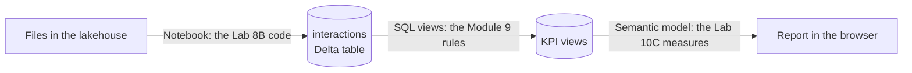

# Module 11: the same flow in Microsoft Fabric

Time: 25 minutes. Trainer demo. You watch; no laptop needed.

Today you built every step yourself, on your own VM with its own database. Microsoft Fabric puts the same steps in one place in the cloud, run by the company instead of by each person. This demo shows the steps you already know, in their Fabric clothes.

## What you will see

| Today on your VM | In Fabric | What changes |
|---|---|---|
| PostgreSQL `src` schema | A lakehouse: files and tables stored in OneLake | Storage is shared and managed for you |
| `build_interactions.py`, run in a terminal | The same pandas code in a Fabric notebook | It runs in the cloud and can be scheduled |
| `interactions` table | A Delta table in the lakehouse | A file format that keeps a history of changes |
| KPI views in your schema | Views on the lakehouse's SQL endpoint | The same rules, in Microsoft's SQL dialect (T-SQL). `count(*) FILTER (WHERE ...)` becomes `sum(CASE WHEN ... THEN 1 ELSE 0 END)` |
| Power BI Desktop, Import mode, Refresh | A semantic model and a report in the browser, refreshed on a schedule | No laptop needed to refresh, no gateway for data already in Fabric |

## The words

| Word | Meaning |
|---|---|
| Workspace | A shared folder for a team's data and reports |
| Lakehouse | A store for both files (like CSVs) and tables, in one place |
| OneLake | The single storage that every Fabric workspace in a company uses |
| Notebook | A page of code cells you run one at a time, here in the browser |
| Delta table | A table saved as files, which remembers earlier versions |
| SQL analytics endpoint | A way to query lakehouse tables with ordinary SQL |
| Semantic model | Power BI's model (tables, relationships, measures) living in the Service instead of a .pbix file |
| Capacity | The paid compute a company buys for Fabric. Everything in a workspace runs on it |

## Questions to think about while you watch

1. Which parts of today's code did the trainer have to change to run in Fabric?
2. What did the trainer not have to do that you did today?
3. Who in a company would need to set this up before a reporting team could use it?

Answers

1. Very little. The read and write lines change from PostgreSQL to the lakehouse, and the views are written in T-SQL, where `FILTER` is not available. The cleaning rules, the KPI definitions and the measures are the same.
2. Keep a VM or laptop on to refresh, install a gateway, or run a script from a terminal each morning.
3. An administrator: someone has to buy or switch on a capacity, create the workspace and give people access with work accounts.

## Done for the day

Go back to the [course README](../README.md) for what to try next.
