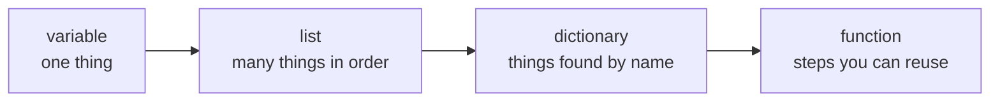

# Module 2: Python from zero

Time: 90 minutes

Python is a language for giving a computer instructions. You write the instructions in a file, and Python carries them out one line at a time, from top to bottom. That is all programming is: clear instructions in the right order.

You will not become a programmer today. You will learn to read simple Python, change it safely, and run it. That is enough to understand the data pipeline in Module 5.

## How the module works

| Lab | What you do | Time |
| --- | --- | --- |
| [Lab 2A](lab-2a-python-prompt.md) | Type Python directly and see answers at once | 15 min |
| [Lab 2B](lab-2b-first-script.md) | Save instructions in a file and run the file | 20 min |
| [Lab 2C](lab-2c-lists-and-dictionaries.md) | Lists, dictionaries and a function, using real queue numbers | 25 min |
| [Lab 2D](lab-2d-read-a-csv.md) | Load a data file and count calls | 30 min |

You will not use notebooks today. You will write a file, run it from the terminal and read the output. Tomorrow's Fabric notebooks will make more sense because you already know what each line does.

## Five ideas that cover the module

> [!TIP]
> A variable is a labelled jar. You put something in and write a name on the front. A list is a shopping list: items in order, and you can add to it. A dictionary is the contacts app on your phone: you look something up by name, not by position. A function is a recipe: put in ingredients, follow the same steps, get a dish. A loop is doing the same task for every item on the list.



## How to read a line of Python

```python
answer_rate = answered / offered * 100
```

Read it from right to left. Take `answered`, divide by `offered`, multiply by 100, and put the result in the jar named `answer_rate`. The `=` sign means "put into", not "equals".

## Three rules that avoid most errors

1. Python cares about capital letters. `Calls` and `calls` are different names.
2. Text goes inside quotes. Numbers do not.
3. Lines inside a loop, a function or an `if` start with the same number of spaces. VS Code adds them for you when you press Enter after the colon.

## What an error message looks like

Errors look scary and are helpful. Always read the last line first. It names the problem. The lines above it say where.

```text
  File "work\answer_rate.py", line 8
    print("Queue:, queue_name)
          ^
SyntaxError: unterminated string literal (detected at line 8)
```

The last line says a piece of text was never closed. The `^` points to the opening quote. The fix is to put the missing quote back. You will break something on purpose in Lab 2B so you can see this once while it is safe.

## Check yourself

1. Which holds items you find by name, a list or a dictionary?
2. What does the `=` sign mean in `calls = 573`?
3. Which line of an error message do you read first?

<details>
<summary>Answers</summary>

1. A dictionary.
2. Put the value 573 into the jar named `calls`.
3. The last line.

</details>
