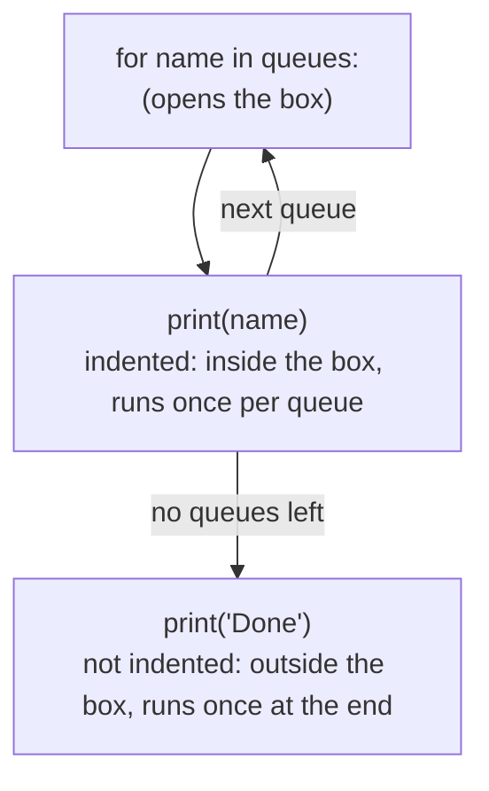

# Lab 2C: lists, dictionaries and a function

Time: 35 minutes

Goal: handle several queues at once, instead of one at a time, using real call counts from 1 October.

You need: Lab 2B finished. You will build one file, `work/queues.py`, in four parts. Run it after each part.

## Before you start: indentation

Python uses the empty space at the start of a line to decide which lines belong together. This is called indentation. If you have used RPA or Power BI tools, you already know the idea. Python just draws it with spaces instead of boxes.

> [!TIP]
> In UiPath or Power Automate, a "For each" activity is a box. Whatever you drag inside the box runs once per item. Whatever sits below the box runs once at the end. In Python there is no box on screen, so the indent is the box. Lines pushed in to the right are inside. Lines at the left edge are outside.

Here is the same idea as a picture:



### Try it: spot the difference

Create a file `work/indent_demo.py` and type:

```python
queues = ["Billing", "Claims"]

for name in queues:
    print("Checking", name)
print("Done")
```

Run it: `python work\indent_demo.py`

You should see:

```text
Checking Billing
Checking Claims
Done
```

Now push `print("Done")` in with four spaces so it looks like this:

```python
for name in queues:
    print("Checking", name)
    print("Done")
```

Run it again. You should see:

```text
Checking Billing
Done
Checking Claims
Done
```

"Done" now runs once per queue because it is inside the box.

Finally remove the indent from the first `print`, so both lines start at the left edge, directly under the `for` line. Run it. You should see an error that ends with:

```text
IndentationError: expected an indented block after 'for' statement on line 3
```

Python is saying: you opened a box with the `for` line and put nothing inside it.

> [!NOTE]
> What this does: the line ending with a colon `:` opens a box. Every line indented by four spaces under it is inside the box. A line back at the left edge closes the box. Press the Tab key to indent. VS Code also indents for you after a colon when you press Enter. Use four spaces everywhere, and never mix tabs and spaces in one file.

Delete `work/indent_demo.py` or leave it. Now start the lab.

## Part 1. A list

> [!TIP]
> A list is a shopping list: items in order. You can count them, pick one, or add more.

1. Create `work/queues.py` and type this:

```python
# Part 1: a list
queues = ["Billing", "Claims", "Eligibility", "Provider Line"]
print("Queues:", queues)
print("How many:", len(queues))
print("First one:", queues[0])

queues.append("Web Chat")
print("After adding one:", len(queues))

for name in queues:
    print("-", name)
```

2. Save and run: `python work\queues.py`

You should see:

```text
Queues: ['Billing', 'Claims', 'Eligibility', 'Provider Line']
How many: 4
First one: Billing
After adding one: 5
- Billing
- Claims
- Eligibility
- Provider Line
- Web Chat
```

> [!NOTE]
> What this does: square brackets make a list. `len` counts the items. `queues[0]` picks the first item, because Python starts counting at 0, not 1. `append` adds one more item at the end. The `for` line is a loop: it takes each item in turn, puts it in the jar `name`, and runs the indented line below once per item. That indented line starts with four spaces.

## Part 2. A dictionary

> [!TIP]
> A dictionary is the contacts app on your phone. You do not ask for "the third contact". You look someone up by name.

Add this to the bottom of the file:

```python

# Part 2: a dictionary
offered = {"Billing": 573, "Claims": 592, "Eligibility": 413, "Provider Line": 354}
answered = {"Billing": 524, "Claims": 541, "Eligibility": 378, "Provider Line": 324}
print("Billing offered:", offered["Billing"])
```

Save and run. At the bottom of the output you should see:

```text
Billing offered: 573
```

> [!NOTE]
> What this does: curly brackets make a dictionary. Each entry is a name, a colon, and a value. `offered["Billing"]` looks up the value stored under the name Billing. The numbers are the real calls offered and answered on 1 October.

## Part 3. A function

> [!TIP]
> A function is a recipe. You hand it the ingredients, it follows the same steps, and gives you back the dish.

Add this below:

```python

# Part 3: a function
def answer_rate(answered_calls, offered_calls):
    return round(answered_calls / offered_calls * 100, 1)

print("Billing answer rate:", answer_rate(524, 573))
```

Save and run. At the bottom you should see:

```text
Billing answer rate: 91.4
```

> [!NOTE]
> What this does: `def` defines a function and gives it a name. The names in brackets are the ingredients it needs. `return` is the dish it hands back. The body of the function is indented. Defining the function does nothing by itself. The `print` line calls it with real numbers.

## Part 4. Everything together

Add this at the bottom:

```python

# Part 4: all the queues
for name in offered:
    rate = answer_rate(answered[name], offered[name])
    print(name, rate, "percent")
    if offered[name] > 500:
        print("   busy queue")
```

Save and run. At the bottom you should see:

```text
Billing 91.4 percent
   busy queue
Claims 91.4 percent
   busy queue
Eligibility 91.5 percent
Provider Line 91.5 percent
```

> [!NOTE]
> What this does: the loop visits each queue name in the dictionary. For each one it looks up the answered and offered numbers, calls your function, and prints the result. The `if` line only runs its indented line when the condition is true, so only queues with more than 500 calls print "busy queue".

If your file does not work, compare it with [solutions/queues.py](solutions/queues.py).

## Try it yourself

1. Change 500 to 400 and run again. Which queue also becomes busy?
2. Add a new line to each dictionary for `"Web Chat"` and see what the loop prints.

<details>
<summary>Answers</summary>

1. Eligibility (413 calls).
2. Web Chat appears in the output with whatever numbers you gave it.

</details>

## Check yourself

1. How do you get a value out of a dictionary?
2. What does a function's `return` line do?
3. Why are some lines indented?

<details>
<summary>Answers</summary>

1. Put the name in square brackets after the dictionary, for example `offered["Billing"]`.
2. It hands the result back to whoever called the function.
3. The indented lines belong to the loop, function or `if` above them.

</details>

## Done?

Next is [Lab 2CA](lab-2ca-practice.md), where you practise on your own with hints. Then [Lab 2D](lab-2d-read-a-csv.md) loads real data.
