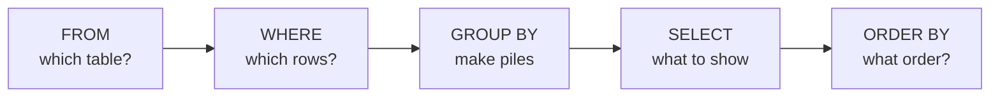

# Module 3: SQL from zero

Time: about 155 minutes of labs plus a 15 minute trainer demo

SQL (say "sequel" or "S-Q-L") is the language for asking questions of a database. Almost every reporting team in the world uses it. You do not need to remember it all. You need to be able to read a query and change a few words in it.

## What a database is

> [!TIP]
> A database is a filing room. A table is one cabinet, for example the cabinet of calls. A row is one folder, which is one call. A column is one question that every folder answers, such as "how long did the caller wait?"

SQL is how you talk to the clerk who looks after the filing room.

> [!TIP]
> You do not tell the clerk how to search. You say what you want ("all the abandoned calls, longest wait first") and the clerk works out the route.

## Every query has the same shape

```sql
SELECT call_id, wait_sec     -- which columns do I want to see?
FROM practice.calls          -- which table?
WHERE outcome = 'abandoned'  -- which rows?
ORDER BY wait_sec DESC;      -- in what order?
```

Two things to know about the notation:

* Words after `--` are comments. The database ignores them.
* The `;` at the end says the query is finished.

The database does not read the query in the order you write it. It reads it in this order, and if a result looks wrong it helps to walk through the boxes from left to right:



## The plan for the afternoon

| Lab | What you do | Data | Time |
| --- | --- | --- | --- |
| [Lab 3A](lab-3a-first-queries.md) | Connect, look inside tables | 20 practice calls | 30 min |
| [Lab 3B](lab-3b-filter-sort-count.md) | Filter, sort and count | 20 practice calls | 25 min |
| [Lab 3C](lab-3c-group-by.md) | Group rows into piles | 20 practice calls | 20 min |
| [Lab 3D](lab-3d-join.md) | Join two tables | 20 practice calls | 20 min |
| [Lab 3E](lab-3e-call-centre-numbers.md) | Work out abandonment, handling time and service level, by hand first | 20 practice calls, then 1,939 real calls | 45 min |
| [Demo 3F](demo-3f-going-further.md) | Leaderboards, running totals, first contact resolution | trainer-led | 15 min |

You start with only 20 calls on purpose. You can check every answer by eye. Once you trust your queries, you point them at the full data.

## The numbers you will work out

| Name | Everyday picture | Plain definition |
| --- | --- | --- |
| Abandonment rate | People who give up and leave the bank queue before reaching a teller | Abandoned calls divided by calls offered |
| Short abandon | Someone who pressed the wrong button and hung up at once | A call abandoned in 5 seconds or less. We leave these out |
| AHT (average handle time) | How long one customer spends at the counter, paperwork included | Talk time plus hold time plus after-call work, averaged over answered calls |
| Service level (SL) | The share of pizzas delivered inside the promised 30 minutes | Calls answered within the target time, divided by calls that were answered or abandoned after the target |

The target for these practice queues is 20 seconds. The full definitions are in the [KPI definitions](../appendix/kpi-definitions.md).

## The cheat sheet

Keep the [SQL cheat sheet](../appendix/sql-cheat-sheet.md) open. It has every pattern from this module on one page.
