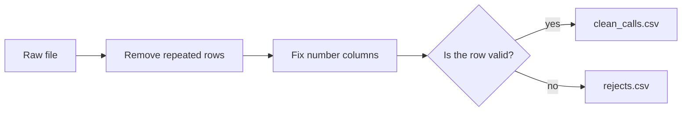

# Module 4: cleaning data with Python

Time: 75 minutes

Real data is never tidy. Rows are repeated, numbers arrive as words, and fields are blank when they should not be. If you build a report on top of that, the report is wrong and nobody notices. Cleaning is the step that stops this.

In this module you write one small Python script that cleans a file, saves the good rows, and saves the bad rows somewhere you can look at them. You build it on a 12-row file first, where you can see every row. Then you run the same script on a full day of 1,939 calls.

## The idea

> [!TIP]
> Cleaning data is what a kitchen does before cooking. You wash the vegetables, remove the bad ones and put them aside, and only then start the recipe. A good cook does not throw the bad vegetables away without looking. They check why they were bad.

Your script follows the same order every time:

## Three problems you will meet

| Problem | What it looks like | Why it hurts |
|---|---|---|
| Repeated rows | The same call appears twice | Every count is too high |
| Numbers stored as text | A wait time of `unknown` in a column of numbers | Python cannot add or average the column |
| Missing values | An answered call with no agent | You cannot say who handled it |

## Labs

| Lab | What you do | Time |
|---|---|---|
| [Lab 4A](lab-4a-inspect.md) | Open a messy file and find the problems by looking | 20 min |
| [Lab 4B](lab-4b-clean.md) | Write the cleaning script and run it on the 12-row file | 30 min |
| [Lab 4C](lab-4c-real-day.md) | Run the same script on a full day and check the numbers | 25 min |

## Words used in this module

| Word | Meaning |
|---|---|
| Duplicate | A row that is an exact copy of another row |
| NaN | "Not a number". How pandas shows an empty or unreadable value |
| Reject | A row that fails a rule and is saved separately instead of used |
| Boolean mask | A list of True and False values, one per row, used to pick rows |

Start with [Lab 4A](lab-4a-inspect.md).
