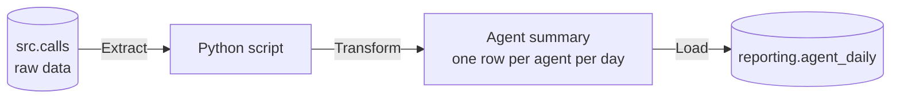

# Module 5: a daily data pipeline

Time: 75 minutes

In Module 4 you cleaned one file by running a script yourself. A real reporting team cannot do that every morning. They build a pipeline: a script that runs the same steps on the new data each day, and can be run again safely if something goes wrong.

The standard name for this pattern is ETL, which stands for Extract, Transform, Load.

## The three steps

> [!TIP]
> ETL is a kitchen. Extract is fetching ingredients from the store room. Transform is chopping, mixing and cooking them. Load is putting the finished dish on the counter for customers. The customers never see the store room.

| Step | In this module | Plain meaning |
|---|---|---|
| Extract | Read answered calls from `src.calls` | Get the raw data |
| Transform | Add handle time, group by agent and day | Turn many rows into a summary |
| Load | Write the summary into `reporting.agent_daily` | Store it where reports can read it |

## Two ideas that make a pipeline trustworthy

### Running it twice is safe

> [!TIP]
> A lift button works this way. Pressing it five times does not call five lifts. The lift is coming either way. A good pipeline is built the same way: run it once or run it ten times, the table ends up the same.

The technical word is idempotent. The script achieves it by using an upsert: insert a row if it is new, update it if it is already there. The SQL is `INSERT ... ON CONFLICT DO UPDATE`.

### Remember where you stopped

> [!TIP]
> A bookmark in a book. You do not start from page 1 each night. You open at the bookmark, read on, and move the bookmark.

The script stores the last day it loaded in a small table called a watermark. Each run only processes days after it.

### All or nothing

> [!TIP]
> A bank transfer. If the money leaves your account but the crash happens before it reaches the other account, the bank puts it back. The script does the same. It does all the loading in one transaction, so a crash half way leaves nothing behind.

## Labs

| Lab | What you do | Time |
|---|---|---|
| [Lab 5A](lab-5a-mini-etl.md) | Build a tiny ETL on 20 calls and see why running twice matters | 30 min |
| [Lab 5B](lab-5b-real-etl.md) | Run the real ETL on 30 days of data and check the result | 35 min |
| [Demo 5C](demo-5c-new-day.md) | Trainer adds a new day and you run the pipeline again | 10 min |

Start with [Lab 5A](lab-5a-mini-etl.md).
