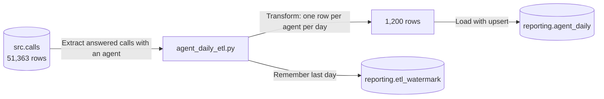

# Lab 5B: run the real pipeline

Time: 35 minutes

Goal: run an ETL that summarises 30 days of calls into one row per agent per day, check it, run it again safely, and change one rule.

You need: Lab 5A finished, a working `.env` file, and the database running.

## What you are building



## Step 1. Create the two target tables

Open pgAdmin and the Query Tool on `contact_centre`. Paste this and press F5:

```sql
CREATE TABLE IF NOT EXISTS reporting.agent_daily (
    agent_id         int  NOT NULL,
    summary_date     date NOT NULL,
    calls_handled    int  NOT NULL,
    aht_sec          int  NOT NULL,
    longest_call_sec int  NOT NULL,
    loaded_at        timestamptz NOT NULL DEFAULT now(),
    PRIMARY KEY (agent_id, summary_date)
);

CREATE TABLE IF NOT EXISTS reporting.etl_watermark (
    job_name         text PRIMARY KEY,
    last_loaded_date date NOT NULL
);
```

You should see `CREATE TABLE` (or `Query returned successfully`).

> [!NOTE]
> What this does: it makes two empty tables in the `reporting` schema. The first holds the summary. Its primary key `(agent_id, summary_date)` says there can only be one row per agent per day, which is what lets the upsert work. The second is the bookmark, one row per job. `IF NOT EXISTS` means running the SQL again does no harm.

The same SQL is saved in `module-5-etl/etl_setup.sql`.

## Step 2. Read the script before running it

Open `module-5-etl/agent_daily_etl.py` in VS Code. You do not need to understand every line. Find these pieces:

| Look for | What it does |
|---|---|
| `def get_watermark` | Reads the bookmark: the last day already loaded |
| `def extract` | Runs a SQL query to get answered calls with an agent. `DISTINCT` removes repeated rows |
| `def transform` | Adds up talk, hold and wrap time, then groups by agent and day |
| `UPSERT` | The `INSERT ... ON CONFLICT DO UPDATE` statement |
| `with engine.begin()` | Opens the all-or-nothing transaction |
| `log.info(...)` | Prints a progress message and saves it to `etl.log` |

The script works on its own because it was written to use the same names you have seen in earlier labs.

## Step 3. Run it

In the terminal, from the course folder:

```powershell
python module-5-etl\agent_daily_etl.py
```

You should see five lines. The times at the start will be different:

```text
2026-10-22 16:04:49,275 INFO Extracting 2026-09-02 to 2026-10-01
2026-10-22 16:04:49,637 INFO Extracted 46454 calls
2026-10-22 16:04:49,659 INFO Transformed into 1200 agent-day rows
2026-10-22 16:04:49,691 INFO Loaded. Watermark is now 2026-10-01
```

If you see `DATABASE_URL is not set`, your `.env` file is missing or in the wrong folder. Run `python check_setup.py` to find out which.

> [!NOTE]
> What this does: the script read the bookmark (nothing yet, so it starts at 2 September), pulled 46,454 answered calls, grouped them into 1,200 rows (40 agents times 30 days), and wrote them. Then it moved the bookmark to 1 October.

## Step 4. Check the result in the database

In pgAdmin, run:

```sql
SELECT count(*) AS agent_day_rows, sum(calls_handled) AS calls_handled
FROM reporting.agent_daily;
```

You should see:

```text
 agent_day_rows | calls_handled
----------------+---------------
           1200 |         46454
```

The 46,454 matches the number the script printed as extracted. Every call is in exactly one summary row.

Now look at one agent:

```sql
SELECT * FROM reporting.agent_daily
WHERE agent_id = 1
ORDER BY summary_date
LIMIT 3;
```

The first row should show agent 1 on 2 September: 44 calls handled, AHT 318 seconds, longest call 881 seconds.

Finally check the bookmark:

```sql
SELECT * FROM reporting.etl_watermark;
```

You should see `agent_daily` with `2026-10-01`.

One more check ties this to Module 4. Add up 1 October:

```sql
SELECT sum(calls_handled) FROM reporting.agent_daily WHERE summary_date = '2026-10-01';
```

You should see 1763, the same as the answered calls in your cleaned file from Lab 4C. Two different tools, the same answer.

## Step 5. Run it again

Run the same command again:

```powershell
python module-5-etl\agent_daily_etl.py
```

You should see:

```text
2026-10-22 16:04:50,801 INFO Nothing new after 2026-10-01. Done.
```

Run the count query from Step 4 again. It still says 1200 rows and 46454 calls. Running the pipeline twice changed nothing, unlike the history file in Lab 5A.

## Step 6. Change one rule

Managers say the average handle time is pulled up by a few very long calls and they want the median instead. The median is the middle value when the numbers are sorted, so a few extremes do not move it.

1. Open `module-5-etl/agent_daily_etl.py`.
2. Find the line with `"mean"` (around line 62). Change the word `"mean"` to `"median"`. Keep the quote marks.
3. Save the file.
4. Run `python module-5-etl\agent_daily_etl.py --reset` in the terminal. This empties the table and the bookmark.
5. Run `python module-5-etl\agent_daily_etl.py` again.
6. In pgAdmin, run the agent 1 query from Step 4 again.

You should see `Reset: agent_daily emptied and watermark removed` after step 4. After step 5 you see the same four log lines as Step 3. The agent 1 row for 2 September now shows AHT 275 instead of 318.

> [!NOTE]
> What this does: `--reset` is needed because the watermark says everything is already loaded, so without it the script would find nothing new and your change would never be applied. Changing "mean" to "median" changes how the one number per agent per day is worked out.

> [!WARNING]
> Never run `--reset` on a real production table without telling the people who use it. It empties the table.

Change `"median"` back to `"mean"`, run `--reset` and run the script once more, so the table has the standard definition for the next lab.

## Check yourself

1. What does the watermark table do?
2. What would happen if the script crashed after writing 600 rows?
3. Why did we need `--reset` in Step 6?
4. Why must `(agent_id, summary_date)` be unique?

<details>
<summary>Answers</summary>

1. It remembers the last day that was loaded, so the next run starts after it.
2. Nothing would be saved. The whole load is one transaction, which rolls back if there is an error.
3. The watermark said all days were done, so the script would have found nothing new and skipped the change.
4. The upsert needs a rule for deciding whether a row already exists. The pair agent and date identifies a row.

</details>

## Done?

Next is [Demo 5C](demo-5c-new-day.md): the trainer adds a new day of data.
