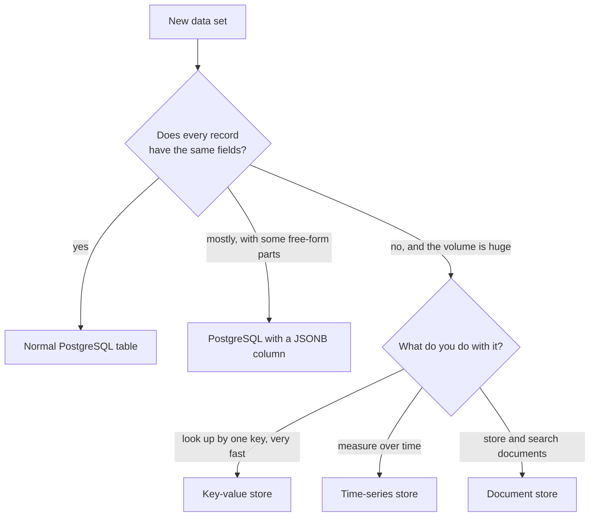

# Module 6: data that does not fit in rows and columns

Time: 20 minutes, trainer-led. You follow along and answer at the end.

So far every table had the same columns for every row. Some data is not like that. A chat transcript is a conversation. One chat has 5 messages and another has 12, and each message has a sender, a time and some text. Forcing that into fixed columns is awkward.

## NoSQL in one page

NoSQL means "not only SQL". It is a family of databases for data that does not fit neat tables, or that arrives too fast for one machine. Three kinds are worth knowing today.

> [!TIP]
> A document store is a patient folder. Every folder has a name on the front, but what is inside differs: one has an X-ray, another has three letters and a lab report. Nobody forces them into the same form.
>
> A key-value store is the coat check at a theatre. You hand over a ticket number and get your coat back almost at once. You cannot ask the attendant for "every red coat".
>
> A time-series store is the trace on a heart monitor. Its only job is to record one value after another along a clock, and to answer "what happened between 2 and 3 pm?"

| Kind | Best at | Contact centre example |
|---|---|---|
| Document | Records whose shape changes | Chat transcripts |
| Key-value | Very fast lookups by one id | The current state of a live call |
| Time-series | Values measured along a clock | Queue depth every second, for a live wallboard |

## PostgreSQL has a drawer for this

PostgreSQL can keep a document inside an ordinary table, in a column of type JSONB. It is a normal filing cabinet with one drawer for loose envelopes. You get the flexibility of a document and keep joins and SQL.



## What JSON looks like

JSON is a way of writing a document as text. Curly braces `{}` hold named items. Square brackets `[]` hold a list.

```json
{
  "messages": [
    { "sender": "customer", "text": "Where is my claim?" },
    { "sender": "agent", "text": "Let me check that for you." }
  ]
}
```

This document has one item called `messages`. It is a list of two messages. Each message has a `sender` and some `text`.

## Demo: query chat transcripts

The trainer runs the queries in [demo.sql](demo.sql) one at a time. Follow along in pgAdmin if you like. Every query only reads data.

### Step 1. Look at one transcript

```sql
SELECT chat_id, jsonb_pretty(transcript) AS transcript
FROM src.chats
WHERE transcript IS NOT NULL
ORDER BY chat_id
LIMIT 1;
```

You should see the first chat laid out as a list of messages, each with a `ts` (time), `text` and `sender`. The first message is from the customer: "Where is my claim?"

> [!NOTE]
> What this does: `jsonb_pretty` lays the packed document out with line breaks so a person can read it. The data is not changed.

### Step 2. Count messages in each chat

```sql
SELECT chat_id, jsonb_array_length(transcript -> 'messages') AS messages
FROM src.chats
WHERE transcript IS NOT NULL
ORDER BY chat_id
LIMIT 5;
```

You should see 9, 9, 7, 10 and 5 messages for chats 1, 3, 4, 5 and 6.

> [!NOTE]
> What this does: the arrow `->` means "go into the document and fetch the part with this name". Here it fetches the list called `messages`, and `jsonb_array_length` counts the items in that list. Chat 2 is missing because it was abandoned and has no transcript.

### Step 3. Average length of a chat

```sql
SELECT round(avg(jsonb_array_length(transcript -> 'messages')), 1) AS avg_messages
FROM src.chats
WHERE transcript IS NOT NULL;
```

You should see 7.5.

### Step 4. Search inside the conversations

How many chats include a customer message that mentions a bill?

```sql
SELECT count(*) AS chats_mentioning_bill
FROM src.chats
WHERE jsonb_path_exists(transcript, '$.messages[*] ? (@.sender == "customer" && @.text like_regex "bill")');
```

You should see 6825.

> [!NOTE]
> What this does: `jsonb_path_exists` searches inside the document. The pattern in quotes reads: any message where the sender is the customer and the text contains the word bill.

### Step 5. What do customers say first?

```sql
SELECT m ->> 'text' AS first_message, count(*) AS chats
FROM src.chats, jsonb_array_elements(transcript -> 'messages') WITH ORDINALITY AS t(m, n)
WHERE n = 1
GROUP BY 1
ORDER BY chats DESC;
```

You should see six different opening lines, each in about 2,400 chats. "I was charged twice" is the most common with 2,475.

> [!NOTE]
> What this does: `jsonb_array_elements` turns every message into its own row, and `WITH ORDINALITY` numbers them 1, 2, 3 inside each chat. Keeping only number 1 gives the opening message. `->>` fetches the text as plain text.

## Check yourself

1. Why is a chat transcript a poor fit for a table with fixed columns?
2. What does the `->` arrow do?
3. A new data set has the same ten fields on every record. Which kind of storage fits?

<details>
<summary>Answers</summary>

1. Every chat has a different number of messages, so fixed columns would either run out or sit mostly empty.
2. It reaches into a JSON document and takes one named part.
3. A normal PostgreSQL table.

</details>

## Done?

That is the end of Day 1. Fill in the end-of-day feedback form your trainer shares, and make sure you can still run `python check_setup.py` without errors. Day 2 builds on the same setup.
