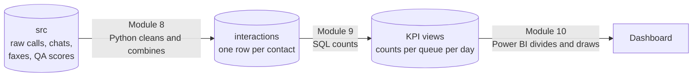
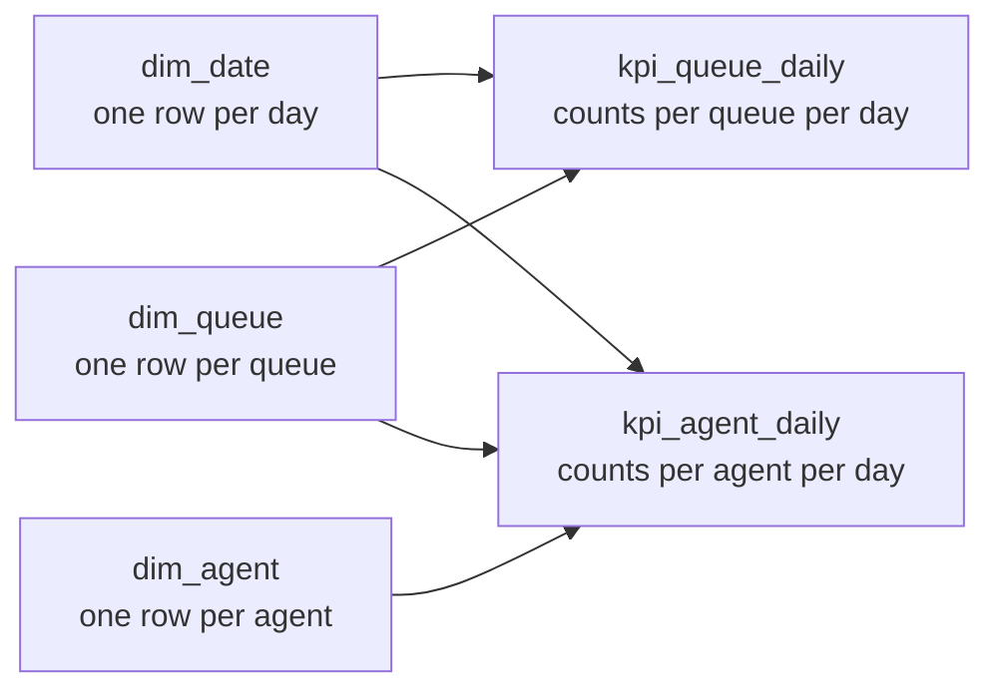

# Module 7: from data to dashboard

Time: 20 minutes (10 minutes of talk, then Lab 7A)

Yesterday you asked questions of the data, cleaned a file and ran a small pipeline. Today you take the same contact centre data all the way to a dashboard a team leader could open every morning.

## The day in one picture

| Step | Module | Tool | What comes out |
|---|---|---|---|
| Get the data | 8 | Python reads from `src` | Three channels in memory |
| Transform | 8 | pandas | One table, `reporting.interactions` |
| Calculate | 9 | SQL views | One row per queue per day, holding counts |
| Show | 10 | Power BI Desktop | A one-page dashboard you can refresh |
| The same in the cloud | 11 | Microsoft Fabric | A trainer demo. You watch |

> [!TIP]
> A restaurant. The store room holds raw ingredients (`src`). The prep kitchen washes and chops them so every cook gets the same thing (Module 8). The menu says exactly what each dish is and how it is made (Module 9). The dining room is where customers see the food (Module 10). Customers never walk into the store room, and the dining room never cooks.

## The one rule for today

**The database counts. Power BI divides.**

Your KPI views will store numbers like "566 calls offered" and "42 abandoned", never "7.4 percent". Power BI divides at the last moment, for whatever days and queues are picked on the screen.

Why it matters: imagine two days. Monday has 1,000 calls and 10 percent abandoned. Tuesday has 10 calls and 0 percent abandoned. The average of the two percentages is 5 percent. But 100 of 1,010 callers gave up, which is 9.9 percent. A dashboard that averages percentages tells you the queue is twice as healthy as it is. If you store the counts, adding them up is always right.

You will prove this on the real data in Lab 9C.

## Lookup lists

A KPI view has ids in it, such as `queue_id = 1`. A small second table says what each id means: queue 1 is Billing, with a 20 second target. You did this as a join in Lab 3D and as a merge in Lab 4D. It is the XLOOKUP idea again.

Power BI calls the big tables of counts *fact tables* and the small lookup lists *dimension tables*. Drawn out, the lookup lists sit around the facts like points of a star, so the shape is called a *star schema*. You will build one in Lab 10B.

## Where your work goes

Your VM has its own database, and you log in as `postgres`, the administrator. Three schemas matter today:

| Schema | What is in it | Who changes it |
|---|---|---|
| `src` | The raw data, as delivered | Nobody, except the new-day script in Lab 10E |
| `reporting` | Everything you build: `interactions`, the KPI views | You |
| `solution` | Finished copies of everything you build today | Lab 7A creates it. Then leave it alone |

As the administrator, nothing stops you changing `src` or `solution` by mistake. Read before you press F5: every `CREATE` and `DELETE` today starts with `reporting.`.

If you fall behind, `solution` is your catch-up path: point a query or Power BI at `solution` instead of `reporting` and carry on.

## Lab

| Lab | What you do | Time |
|---|---|---|
| [Lab 7A](lab-7a-get-ready.md) | Get your database ready for Day 2 and check it | 10 min |
