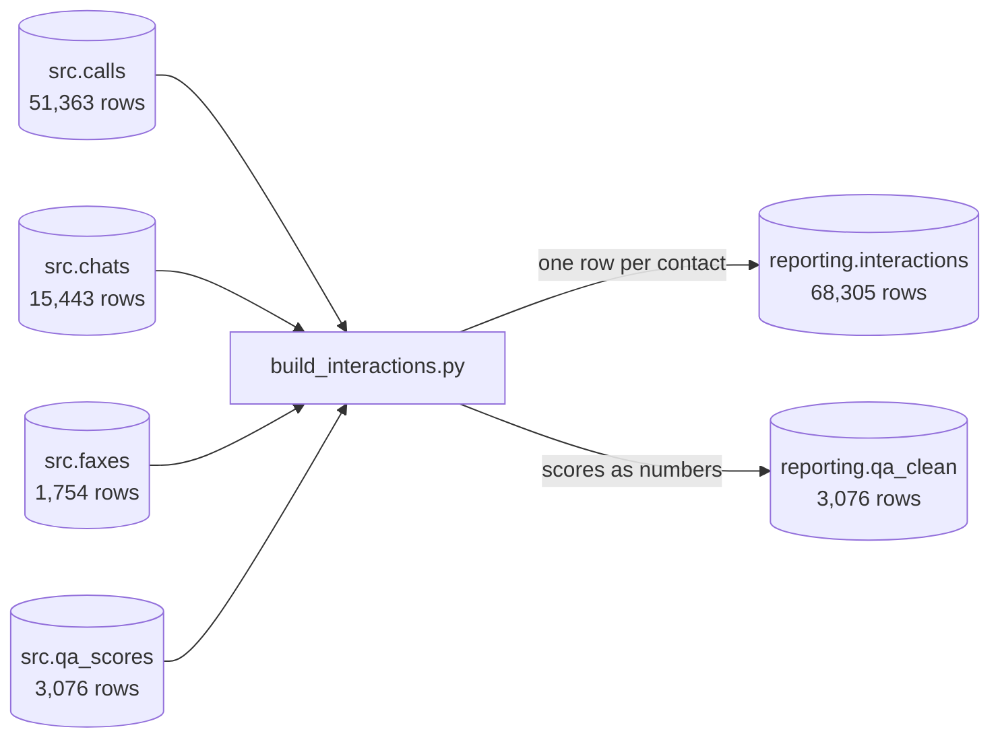

# Lab 8B: one table for all channels

Time: 35 minutes

Goal: run a script that reads calls, chats and faxes from the database, cleans them, stacks them into one table called `reporting.interactions`, and then check the result against the finished copy in `solution`.

You need: Lab 7A and Lab 8A finished.

## What you are building



## Step 1. Read the script before running it

Open `module-8-transform/build_interactions.py` in VS Code. You do not need to understand every line. Find these pieces:

| Look for | What it does | Where you met it |
|---|---|---|
| `def extract` | Reads the four `src` tables with SQL | Lab 5B |
| `drop_duplicates()` | Removes the 255 repeated call rows | Lab 3E, Lab 4B |
| `tz_localize("Asia/Manila")` | Gives chat times their time zone | Lab 8A |
| `str.rstrip("%")` | Turns `85%` into 85 | Lab 8A |
| `pd.concat` | Stacks the three channels into one table | New |
| `is_valid` | Flags answered contacts with no agent, but keeps them | Lab 4D |
| `def load` | Empties the table and fills it again | New |
| `with engine.begin()` | All or nothing: a crash leaves the old table as it was | Lab 5B |

> [!TIP]
> `pd.concat` is stacking three piles of forms that all have the same boxes on them. Before you can stack them, every pile has to use the same box names. That is what the three `transform_...` functions do: rename each channel's columns to the same names.

## Step 2. Run it

In the terminal, from the course folder:

```powershell
python module-8-transform\build_interactions.py
```

It takes about 30 seconds. You should see three lines. The times at the start will be different:

```text
2026-10-23 09:41:02,746 INFO Extracted 51363 calls, 15443 chats, 1754 faxes, 3076 QA scores
2026-10-23 09:41:02,912 INFO Transformed into 68305 interactions (150 flagged not valid)
2026-10-23 09:41:30,467 INFO Loaded reporting.interactions and reporting.qa_clean. Last day: 2026-10-01
```

> [!NOTE]
> 51,363 calls went in and 51,108 calls came out, because the 255 repeated rows were dropped. 51,108 calls plus 15,443 chats plus 1,754 faxes is 68,305.

## Step 3. Check it in pgAdmin

Open the Query Tool on `contact_centre` in pgAdmin. Run:

```sql
SELECT channel, outcome, count(*) AS rows,
       count(*) FILTER (WHERE NOT is_valid) AS not_valid
FROM reporting.interactions
GROUP BY channel, outcome
ORDER BY channel, outcome;
```

You should see:

```text
 channel |  outcome  | rows  | not_valid
---------+-----------+-------+-----------
 chat    | abandoned |   876 |         0
 chat    | answered  | 14567 |         0
 fax     | processed |  1754 |         0
 voice   | abandoned |  4504 |         0
 voice   | answered  | 46604 |       150
```

> [!NOTE]
> What this does: it counts rows in `reporting.interactions` by channel and outcome. `count(*) FILTER (WHERE NOT is_valid)` counts only the flagged rows. All 150 flagged rows are answered calls with no agent. They stay in the table: they still count towards the queue's numbers, but they cannot count towards any agent.

## Step 4. Check the days

```sql
SELECT channel, min(contact_date) AS first_day, max(contact_date) AS last_day,
       count(DISTINCT contact_date) AS days
FROM reporting.interactions
GROUP BY channel
ORDER BY channel;
```

You should see:

```text
 channel | first_day  |  last_day  | days
---------+------------+------------+------
 chat    | 2026-09-02 | 2026-10-01 |   30
 fax     | 2026-09-02 | 2026-10-01 |   22
 voice   | 2026-09-02 | 2026-10-01 |   30
```

Chat has 30 days and no chat lands on 2 October, so the time zone fix worked. Faxes have 22 days because the back office does not work weekends.

## Step 5. Look at three rows

```sql
SELECT channel, source_id, queue_id, agent_id, contact_date, wait_sec, handle_sec, outcome
FROM reporting.interactions
WHERE (channel = 'chat' AND source_id IN (14902, 14929))
   OR (channel = 'fax' AND source_id = 1)
ORDER BY channel, source_id;
```

You should see:

```text
 channel | source_id | queue_id | agent_id | contact_date | wait_sec | handle_sec |  outcome
---------+-----------+----------+----------+--------------+----------+------------+-----------
 chat    |     14902 |        5 |       31 | 2026-10-01   |       31 |        384 | answered
 chat    |     14929 |        5 |          | 2026-10-01   |      114 |          0 | abandoned
 fax     |         1 |        6 |        5 | 2026-09-02   |    14394 |          0 | processed
```

Check them against what you know:

* Chat 14902 started at 08:07:15 and was accepted at 08:07:46. That is 31 seconds of waiting.
* Chat 14929 was abandoned: the customer left after 114 seconds, nobody handled it.
* Fax 1 arrived at 07:01:15 and was processed at 11:01:09. That is 3 hours 59 minutes 54 seconds, which is 14,394 seconds, just inside the 4 hour target of 14,400.

## Step 6. Run it again

Run the same command again:

```powershell
python module-8-transform\build_interactions.py
```

Then run the first query from Step 3 again. The numbers are exactly the same.

> [!NOTE]
> What this does: the `load` function deletes every row in your table, then adds the new rows, inside one transaction. This is the simplest way to be repeat-safe: throw the whole table away and build it again. It works well while the data is small. Module 5's watermark and upsert is the grown-up version for when a full rebuild takes too long.
>
> Why not simply drop the table and create it again? Because in Module 9 you will build views on top of it, and PostgreSQL refuses to drop a table that a view depends on. Deleting the rows keeps the table, so the views keep working.

## Step 7. Compare with the finished copy

Lab 7A built the same table in `solution` with SQL instead of Python. Two different tools, the same rules. If both are right, they match row for row:

```sql
SELECT count(*) AS only_in_mine
FROM (SELECT * FROM reporting.interactions
      EXCEPT ALL
      SELECT * FROM solution.interactions) AS diff;
```

You should see `0`.

> [!NOTE]
> What this does: `EXCEPT ALL` takes every row in your table and removes each one that has an exact twin in the finished copy. What is left over is what only you have. Zero means every one of your rows has a twin. This is how real teams check a rebuilt pipeline against the old one before switching over.

## Check yourself

1. How many calls were removed as repeats?
2. Why are the 150 flagged calls kept instead of deleted?
3. Why does the script delete rows instead of dropping the table?
4. What would Step 4 have shown for chats if the script had used the UTC guess from Lab 8A?

<details>
<summary>Answers</summary>

1. 255. 51,363 rows went in, 51,108 calls came out.
2. The calls really happened and a customer was served, so they count for the queue. They are only left out of agent numbers, because nobody knows which agent took them.
3. Views built on the table depend on it, and PostgreSQL will not drop a table that a view depends on.
4. 31 days, with chats on 2 October, and every day from 2 September onwards would have lost its evening chats to the next day.

</details>

## Done?

Next is [Module 9](../module-9-kpi-views/README.md).
